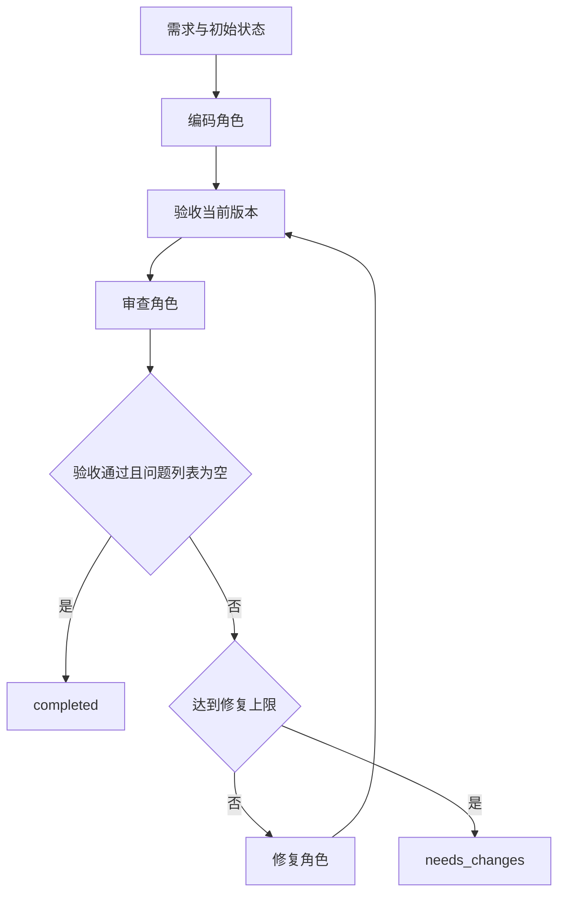

# 模板设计说明

## 当前实现

本项目用普通 Python 展示 Workflow 编排。三个角色共用 ModelClient 接口；DemoModel 提供固定示例，真实模型接入仍待实现。

## 执行流程

任意步骤抛出异常时，流程记录错误并返回 failed。ModelClient 未接入时也遵循这个规则。

## 数据与通信

WorkflowState 是一次任务的共享状态，包含原始需求、当前代码、代码版本、问题列表、验证结果、修复计数、最终状态和历史记录。

runner 从共享状态提取参数传给各角色，把返回值写回共享状态。这就是当前项目的 Agent 间通信，不需要网络通信服务。

修复更新代码后，版本号增加，旧问题和验证结论清空；下一轮针对新版本重新验证。历史记录保存字段副本，不会随当前状态一起变化。

## 各模块职责

| 模块 | 职责 |
|---|---|
| main | 命令行、对象创建、进度显示、保存报告 |
| runner | 顺序、分支、循环与终止条件 |
| agents | 组织角色输入、检查输出格式 |
| llm | 模型调用接口与固定演示实现 |
| prompts | 各角色的任务要求 |
| tools | 固定验收用例与代码执行 |
| state | 明确共享状态和验证结果的结构 |

## 结束规则

- 没有审查问题，且当前版本验收通过：completed。
- 仍有审查问题或验收失败，并且达到修复上限：needs_changes。
- 模型调用、输出格式校验等步骤发生异常：failed。

max_repairs 只计算修复次数，不计算初始编码。max_repairs 为 2 时，最多生成初版和两次修复版本。

## 验证范围

工具实际运行固定平均值函数的五个验收用例。这些用例只覆盖已列出的情形，不能证明任意程序完全正确。

代码在带超时的子进程和临时目录中执行；这不构成安全沙箱。真实外部代码执行需要单独设计隔离方案。

## 后续扩展点

1. ModelClient.generate：接入模型请求、输出解析、重试。
2. 相应 Agent：接入作业一的工具调用循环。
3. 验收接口：让不同任务提供各自的固定测试。
4. 流程节点：加入其他分析角色，或迁移到 LangGraph。
