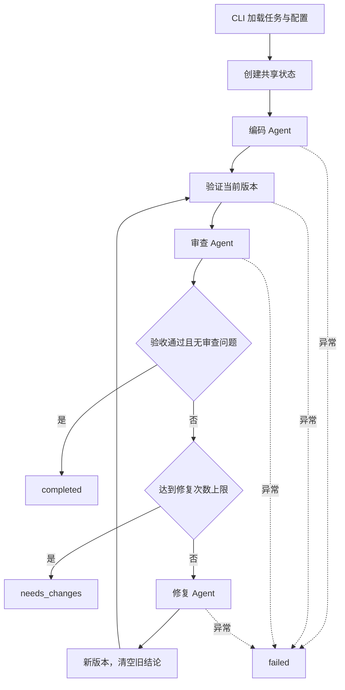

# 代码审查 Workflow 设计

## 目标与边界

实现作业二中的三个角色协作：编码 Agent、审查 Agent、修复 Agent。主程序用普通 Python 表达顺序、条件分支和有限循环，将角色通信、业务验证与基础设施分开。

MVP 处理单文件同步 Python 函数。用户提供自然语言需求、公开函数入口和固定验收；不包含多文件工程修改、复杂调度、Web UI 或自动发布。

## 架构与流程

每个节点完成后触发 observer，保存完整状态快照和事件。这里的回调只负责观察和持久化，不参与决定业务路径。

## Agent 通信协议

| 角色 | 输入 | 输出 |
|---|---|---|
| CodingAgent | 原始 TaskSpec | CodeResult：完整 code、summary |
| ReviewAgent | TaskSpec、当前代码、版本、ValidationResult | ReviewResult：summary、Issue 列表 |
| FixAgent | TaskSpec、当前代码、版本、ReviewResult、ValidationResult | CodeResult |

Issue 含严重程度、当前版本行号、问题、证据和修复建议。三个角色可以使用同一模型，但各自的提示词、任务输入和结果约束独立。

JsonAgent 只负责本角色的消息构造与结构化输出恢复；它不会决定下一个角色是谁。模型输出 JSON 后仍在本地验证字段、类型、长度和行号。格式错误将携带反馈重试，耗尽次数后返回 failed。

本项目采用带角色提示词的 LLM 节点与外层工具编排。验收工具由 Workflow 调用，未增加无需求的自主工具选择循环；作业二允许这样实现简单协作流程。

## 状态与版本一致性

WorkflowState 保存 TaskSpec、当前源码、版本号、当前审查和验收、修复计数、状态、时间、模型用量与事件历史。

关键约束：

1. 原始 TaskSpec 不由 Agent 返回或修改，每个角色都接收原始需求。
2. 编码产出为版本 1，每次修复增加版本号与修复计数。
3. 修复后立即清空旧 review 和 validation，禁止沿用旧代码的通过结论。
4. 验证包含代码版本与 SHA-256，Workflow 核对它们与当前源码一致。
5. 当前审查无问题且当前验收通过，才能 completed。
6. 达到 max_repairs 仍不满足条件时为 needs_changes；执行异常为 failed。

固定验收不能替代需求审查。即使用例通过，审查发现了有证据的问题，仍然进入修复；反之，审查认为无问题也不能覆盖验收失败。

## 验证工具

CodeValidator 先检查语法和顶层同步函数入口，再在临时目录中写入候选代码。独立 Python 子进程通过 stdin 接收固定用例，运行函数并返回结构化结果。

支持普通返回值、嵌套列表与对象、数字绝对误差、预期异常、关键字参数和调用前后输入不变检查。bool 不当作数字通过。异常退出、超时、结果缺失或结构异常都不能视为通过。

子进程标准输出专用于返回结果；被测代码的普通打印转至标准错误。输出写入临时文件，主进程仅读取有限长度。该机制能处理普通错误，不防御恶意代码、子进程派生或操作系统资源滥用，不是安全沙箱。

## 失败与恢复

- 网络错误、408、429、5xx：有上限的指数退避重试。
- 密钥错误、余额不足、参数错误等：直接给出原因，不重复无效请求。
- JSON/字段错误：保留当前角色上下文并附格式反馈，最多重生成指定次数。
- 被截断输出：明确失败，提示调整输出上限或任务规模。
- 验收失败：交由审查和修复循环处理。
- 执行错误：记录 failed、错误说明与已完成快照。

这些机制不包含进程崩溃后的自动续跑。快照用于追踪与诊断，不能直接反序列化后继续调用当前 run。

## 日志与交付

RunStore 按执行步骤保存 snapshots 和 events，按版本保存代码。report.json 是机器可读状态，report.md 用于查看结果。JSON 报告采用临时文件替换，减少写入中断产生半截文件的机会。

配置中的 API 密钥不进入共享状态；HTTP 错误使用受控说明，不打印请求头、原始服务错误或密钥。运行文件默认由 Git 忽略，提交打包采用目录与后缀白名单。

## 可扩展位置

| 扩展 | 建议改动位置 |
|---|---|
| 增加安全/性能审查角色 | agents、prompts，以及 runner 的验收与决策流程 |
| 多文件与仓库差异审查 | CodeResult 改为文件集合，扩展工作目录、补丁与验证器 |
| 真实隔离执行 | 用容器执行后端替换 CodeValidator 的子进程实现 |
| LangGraph 可视化与持久恢复 | 将状态、角色方法与判断分支映射为图与检查点 |
| 测试生成 Agent | 单独生成建议测试，人工确认后加入固定验收，避免自改验收 |
| 不同角色使用不同模型 | 为三个 Agent 分别注入模型，汇总各自用量 |
| GitHub PR 审查 | 增加获取 diff、行号映射和草稿建议输出的适配层 |

当前保留简单顺序执行；并行、数据库和界面应在有明确需求时加入。
