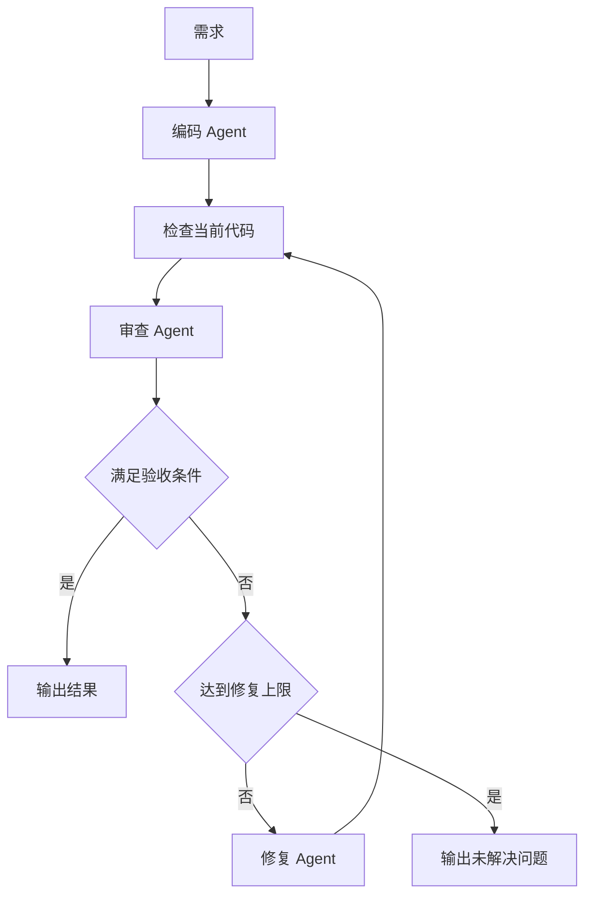

# 设计草稿

本文描述目标设计，当前尚未完成实现。

## 流程

## 共享状态

- requirement：原始需求，全程保留。
- code：当前代码，更新后需要重新检查。
- issues：当前版本的问题列表。
- repair_count：已执行的修复次数。
- max_repairs：允许的最大修复次数。
- status：任务执行状态。

## Agent 接口

- coder(requirement) -> code
- reviewer(requirement, code) -> issues
- fixer(requirement, code, issues) -> code

流程程序负责调用 Agent 和传递状态。Agent 内部可以有独立的模型与工具调用循环。

## 待实现

- 真实模型接入与输出格式校验。
- 验证结果、历史记录和当前代码版本的关联。
- 最大修复次数、超时与失败处理。
- 运行日志与验收测试。
